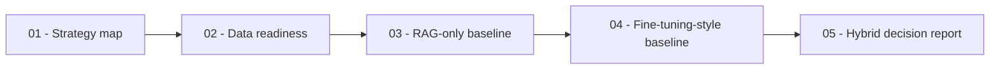

# Fine-Tuning and RAG Strategy

This repository teaches how to choose between
[Retrieval-Augmented Generation (RAG)](https://arxiv.org/abs/2005.11401),
fine-tuning, and hybrid architectures for domain-specific LLM systems. It uses
real chat-completion calls through the
[OpenAI Python client](https://github.com/openai/openai-python), with
[Groq OpenAI compatibility](https://console.groq.com/docs/openai) as the
primary provider and [Mistral chat completions](https://docs.mistral.ai/studio-api/conversations/chat-completion)
as an alternative provider.

## Learning Objectives

By the end of this repository, you should be able to:

- Compare RAG-only, fine-tuning-style, and hybrid architectures on a domain task.
- Explain which failure modes each strategy can and cannot address.
- Inspect whether a dataset is suitable for retrieval, supervised fine-tuning, or evaluation.
- Build provider-backed baselines that make strategy trade-offs measurable without a paid training job.
- Select and justify a strategy using cost, latency, freshness, auditability, and accuracy constraints.

## Learning Path

| File / Folder | Description |
|---|---|
| [**01 - RAG vs Fine-Tuning Strategy Map**](01-rag-vs-finetuning-strategy-map.ipynb) | Compare parametric knowledge, retrieved evidence, and behavior adaptation. |
| [**02 - Domain Data and Fine-Tuning Readiness**](02-domain-data-and-finetuning-readiness.ipynb) | Inspect retrieval, behavior-example, and evaluation data contracts. |
| [**03 - RAG-Only Baseline and Failure Modes**](03-rag-only-baseline-and-failure-modes.ipynb) | Build a transparent retriever and inspect cited answers and abstention. |
| [**04 - Fine-Tuning-Style Baseline and Limits**](04-finetuning-only-baseline-and-limits.ipynb) | Use few-shot style conditioning as a proxy, not a real fine-tuning run. |
| [**05 - Hybrid Architecture Decision Report**](05-hybrid-architecture-decision-report.ipynb) | Compare strategy signals and justify the next experiment. |



### Additional Folders and Files

| File / Folder | Description |
|---|---|
| [**assets**](assets/) | Visual aids referenced in the notebooks. |
| [**data**](data/) | Policy documents, support requests, style examples, and decision scenarios. |
| [**strategy_helpers.py**](strategy_helpers.py) | Shared data, provider, and sparse retrieval helpers. |
| [**.env.example**](.env.example) | Optional provider configuration template. |
| [**pyproject.toml**](pyproject.toml) | Project configuration and dependencies. |
| [**uv.lock**](uv.lock) | Dependency lock file. |

## Setup

> [!NOTE]
> Throughout these steps, text in angle brackets like `<repo-name>` is a **placeholder**. Replace it, including the `< >` brackets, with your own value. For example, `cd <repo-name>` becomes `cd mle-finetuning-rag-strategy`.

### 1. Create the Repository from the Template

Click **Use this template** on GitHub.

When creating the repository:

- Set yourself as the **Owner**
- Choose a repository name
- Disable **Include all branches**
- Click **Create repository**

> [!IMPORTANT]
> If you are working in pairs or groups, only **one person** should complete this step.

---

### 2. Add Collaborators (Pairs/Groups Only)

If working with teammates:

1. Open the repository on GitHub
2. Go to **Settings → Collaborators**
3. Add your teammates as collaborators
4. Share the repository link with your team

Teammates should accept the invitation before continuing.

---

### 3. Clone the Repository

Copy the SSH URL from the **Code** button on GitHub, then run:

```bash
git clone <copied-ssh-url>
```

The copied SSH URL will look like `git@github.com:<your-username>/<repo-name>.git`.

---

### 4. Move into the Project Folder and Install Dependencies

The command below installs all dependencies and creates a virtual environment in `.venv/`.

```bash
cd <repo-name>
uv sync
```

All five notebooks run locally without a model download or API key. Without credentials, provider outputs are explicitly simulated examples, not measurements of model quality. Each reply carries a `live`, `simulated`, or `fallback` source label.

---

### 5. Set Up Environment Variables (Optional)

For live model calls, copy the example file and fill in your API key:

```bash
cp .env.example .env
```

Open `.env` and set `LLM_PROVIDER` to `groq` or `mistral`, then add the matching key:

- **Groq (primary):** Create a key at [console.groq.com/keys](https://console.groq.com/keys) and set `GROQ_API_KEY`.
- **Mistral (alternative):** Create a key following the [Mistral API key documentation](https://docs.mistral.ai/admin/security-access/api-keys) and set `MISTRAL_API_KEY`.

`LLM_PROVIDER` selects the preferred provider. If its key is missing, the helper selects the other configured provider. `GROQ_MODEL` and `MISTRAL_MODEL` override model names.

> [!CAUTION]
> Never commit `.env`. It is git-ignored because environment files often hold secrets. Only `.env.example`, with placeholder or default values, belongs in the repository.

---

### 6. Open the Repository in VS Code

> [!NOTE]
> Make sure you open VS Code from the project root so it automatically detects the environment created by `uv sync`.

Launch VS Code in the project root folder:

```bash
code .
```

Then open a notebook and select the Python environment created by `uv sync` as the kernel.

## API Usage Notes

- Without a configured key, `call_model` returns the supplied deterministic example. Provider failures remain visible and also return that example; do not treat fallback responses as live results.
- Notebook 05 compares all three prompt conditions on six requests (18 answer calls plus one reviewer call for a complete live comparison). Simulated and fallback rows do not support a live architecture recommendation. The common rubric measures format, retrieval and citation checks, and concision, not semantic faithfulness or tone.
- A provider selected at startup is used for the run. An API error does not automatically retry with the other provider.
- Live calls may incur costs or hit rate limits. Check model availability and billing in the provider console, and restart the kernel after changing `.env`.

## What This Repository Does Not Fine-Tune

This unit makes real LLM calls, but it does not run a real fine-tuning job. The
preceding **Fine-Tuning Small Models Locally + Evaluation** unit covers actual
local fine-tuning with tools such as
[LoRA](https://arxiv.org/abs/2106.09685),
[Hugging Face PEFT](https://huggingface.co/docs/peft/index), and
[TRL SFTTrainer](https://huggingface.co/docs/trl/main/sft_trainer). This repo
assumes those mechanics are familiar and shifts the question to architecture
choice: when should a team use RAG, fine-tuning, or a hybrid path? The
fine-tuning-style notebooks use few-shot examples as a lightweight proxy for
behavior adaptation so participants can compare RAG-only, behavior-adapted, and
hybrid prompts on the same domain task.

## Exercise Format

The notebooks use small checkpoints throughout the learning path instead of one
large exercise at the end. Concept checks use brief text, image, diagram, or
output questions followed immediately by the answer or explanation.

## Further Reading

- [Retrieval-Augmented Generation for Knowledge-Intensive NLP Tasks](https://arxiv.org/abs/2005.11401): the original RAG paper combining parametric and non-parametric memory.
- [Groq OpenAI compatibility](https://console.groq.com/docs/openai): provider setup used by the notebooks.
- [Mistral API keys](https://docs.mistral.ai/admin/security-access/api-keys): key setup for the alternative provider.
- [LoRA: Low-Rank Adaptation of Large Language Models](https://arxiv.org/abs/2106.09685): the paper behind a common parameter-efficient fine-tuning approach.
- [Hugging Face PEFT](https://huggingface.co/docs/peft/index): practical adapter and parameter-efficient fine-tuning tooling.
- [Hugging Face TRL SFTTrainer](https://huggingface.co/docs/trl/main/sft_trainer): supervised fine-tuning trainer documentation.
- [Mistral fine-tuning documentation](https://docs.mistral.ai/capabilities/finetuning/text_vision_finetuning/): hosted provider fine-tuning workflow and data expectations.
- [OpenAI fine-tuning data formatting](https://help.openai.com/en/articles/6811186-how-do-i-format-my-fine-tuning-data-for-the-openai-api): provider guidance for supervised fine-tuning examples.
